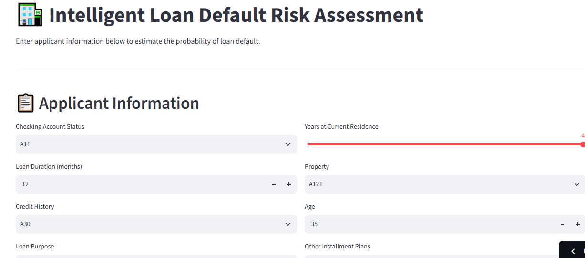
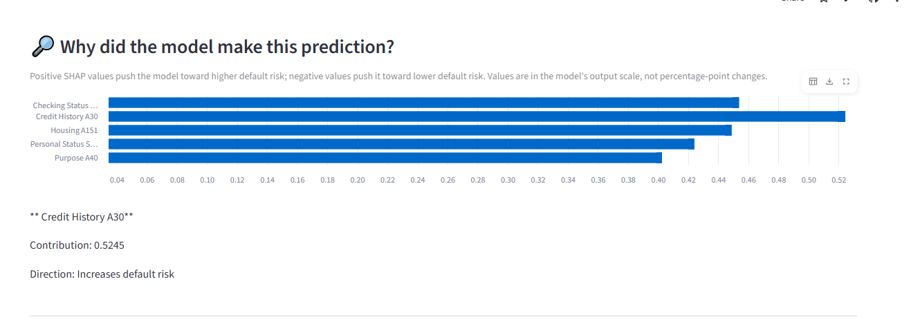
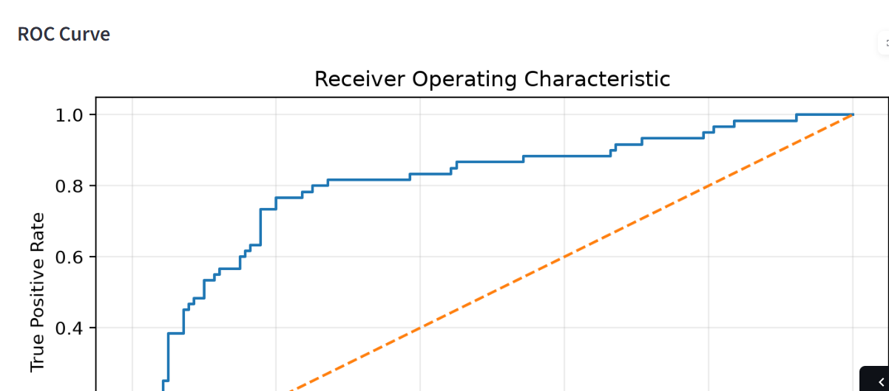

# 🏦 Intelligent Loan Default Prediction & Risk Scoring System

An end-to-end machine learning project that estimates loan default risk using applicant credit information. The application provides risk scores, risk categories, model evaluation metrics, and SHAP-based explanations to help users understand the factors influencing a prediction.

## 🚀 Live Demo

**Try the application:** [Open Loan Risk Assessment App](https://loan-default-risk-system-bmntu4wz8zneajwnmarjqh.streamlit.app/)


## 📸 Application Screenshots

### 1. Loan Risk Assessment Dashboard
Enter applicant details and view the predicted default probability, risk score, and risk category.



### 2. Explainable AI — SHAP Analysis
Explore the factors that contribute to an individual prediction.



### 3. Confusion Matrix
Review correct and incorrect classifications on the evaluation dataset.


### 4. ROC Curve
Visualize the model's ability to distinguish between good-credit and bad-credit cases.



## 🎯 Project Objectives

- Estimate the probability of loan default from credit applicant information.
- Convert model predictions into interpretable risk scores and risk categories.
- Evaluate model performance using multiple classification metrics.
- Explain individual predictions using SHAP.
- Deploy an interactive application using Streamlit.

## ✨ Key Features

- Interactive applicant assessment form
- Default probability and risk score
- Low-, medium-, and high-risk categories
- SHAP-based feature contribution explanations
- Accuracy, precision, recall, F1-score, and ROC-AUC
- Confusion matrix and ROC curve
- Web-based interface built with Streamlit

## 🧠 Machine Learning Approach

- **Dataset:** German Credit dataset
- **Model:** Logistic Regression
- **Preprocessing:** Scikit-learn preprocessing pipeline for categorical and numerical features
- **Evaluation:** Classification metrics, confusion matrix, and ROC-AUC
- **Explainability:** SHAP
- **Decision threshold:** 0.35 for the bad-credit class

## 📊 Model Performance

Results on the held-out evaluation set:

| Metric | Result |
|---|---:|
| Accuracy | 77.5% |
| Precision — Bad Credit | 59.7% |
| Recall — Bad Credit | 76.7% |
| F1-score — Bad Credit | 67.2% |
| ROC-AUC | 0.804 |

The selected threshold prioritizes identifying more potential bad-credit cases, with a corresponding trade-off in false-positive predictions.

## 🛠️ Technology Stack

- **Language:** Python
- **Data processing:** Pandas, NumPy
- **Machine learning:** Scikit-learn
- **Explainable AI:** SHAP
- **Visualization:** Matplotlib, Seaborn
- **Web application:** Streamlit
- **Model persistence:** Joblib
- **Development environment:** VS Code
- **Version control:** Git and GitHub

## 📁 Project Structure

```text
loan-default-risk-system/
├── app/
│   └── app.py
├── models/
│   ├── loan_risk_model.pkl
│   ├── evaluation/
│   └── shap/
├── notebooks/
│   └── 01_understanding_data.ipynb
├── screenshots/
│   ├── prediction-dashboard.png
│   ├── shap-explanation.png
│   ├── confusion-matrix.png
│   └── roc-curve.png
├── src/
│   ├── evaluate_model.py
│   ├── predict.py
│   └── test_prediction.py
├── .gitignore
├── README.md
└── requirements.txt
```

## 💻 Run Locally

### 1. Clone the repository

```bash
git clone https://github.com/prachisahu9130-coder/loan-default-risk-system.git
cd loan-default-risk-system
```

### 2. Create and activate a virtual environment

Windows PowerShell:

```powershell
python -m venv venv
.\venv\Scripts\Activate.ps1
```

### 3. Install dependencies

```bash
pip install -r requirements.txt
```

### 4. Start the application

```bash
streamlit run app/app.py
```

Open the local URL displayed in the terminal.

> Ensure any required local dataset or model artifacts are available. The evaluation artifacts and trained model must match the code and preprocessing pipeline used by the application.

## ⚠️ Limitations and Responsible Use

- This is an educational portfolio project, not a production-ready lending or credit approval system.
- The German Credit dataset is limited and may not represent current lending populations.
- Predictions can be inaccurate and may reflect limitations or biases in the training data.
- SHAP explanations describe model behavior; they do not establish causation.
- The risk score and categories are model-defined indicators, not official credit ratings.
- This application must not be used as the sole basis for real lending decisions.

## 🔮 Future Improvements

- Evaluate additional models and calibrate predicted probabilities.
- Add cross-validation and more extensive error analysis.
- Monitor model drift and evaluate fairness across relevant groups.
- Add automated tests and continuous integration.
- Improve input validation, logging, and deployment monitoring.

## 👩‍💻 About the Author

**Prachi Sahu**  
Aspiring AI/ML Engineer | Python | Machine Learning | Explainable AI

- **GitHub:** https://github.com/prachisahu9130-coder
- **LinkedIn:** www.linkedin.com/in/prachi-sahu-ai3091

I'm building practical AI and machine learning projects focused on explainability, automation, and real-world problem solving.
